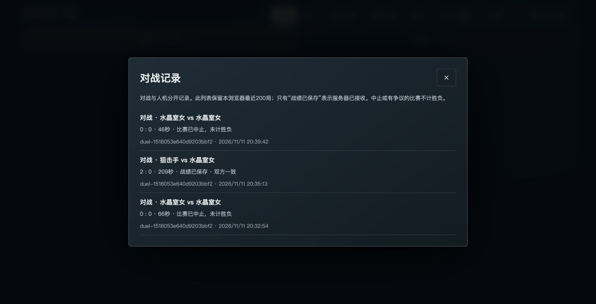

# MySQL9.7 migration readiness

A registry read burst at20 concurrency reproduced9 HTTP503 responses in60 requests on the new host. The rate-counter transaction did a duplicate-key INSERT followed by SELECT FOR UPDATE, causing competing shared-to-exclusive lock upgrades and exhausting retries.

Insert now uses a no-op upsert to take an exclusive lock without replacing existing payload/expiry. The DSN disables CLIENT_FOUND_ROWS so a duplicate reports zero affected rows and remains ErrExists. Limits, CORS, heroes and room protocols are unchanged.

Validation:

- Go1.27.3 full backend tests and race check passed.
- Complete SQL suite passed on an isolated socket-only MySQL9.7.4, including120 concurrent valid counter increments, the180-request limit, and rollback of the refused request.
- Explicit production-v13 roster/protocol profile unchanged; candidate registry JSON exactly matches the old production executable.
- On target Ubuntu/MySQL9.7.4 with existing128MB/25%CPU service limits:120 registry reads,20 concurrency,120 HTTP200, no5xx; p95 243.86ms, max371.36ms.

Candidate SHA256: `e0707769d19812a832e8b7b91ae32608cc850c67e51a4bf4158ad3bc26bfabee` (Linux Go1.27.3, explicit production profile). Now runs on production43.153.33.130. Old43.162.87.40 has been retired after verified migration and offsite backup.

## Production acceptance

- Actual browser peers connected through the existing approved Workers frontend to the production API. WebRTC DataChannels established, RTT1–2ms, hero selection/locking and synchronized battle passed.
- A natural2:0 match ended with both peers showing saved/agreed; MySQL statusconfirmed, scoreAgreementpeer_agreed, transportwebrtc.
- Both peers agreed to same-room rematch and entered another battle. Controlled exit recordedaborted without an extra win. Data quality violations0.
- API domains remain unchanged; production profile/roster/runtime bindings and CORS unchanged. Main-domain static downloads were slow in the test network; no frontend deployment was changed by this migration.
- Both databases/Redis/configuration and current binaries are covered by the verified Mac offsite backupbackup-20261111T125300Z.cms. Daily03:00server and03:20Mac;15min monitoring.

